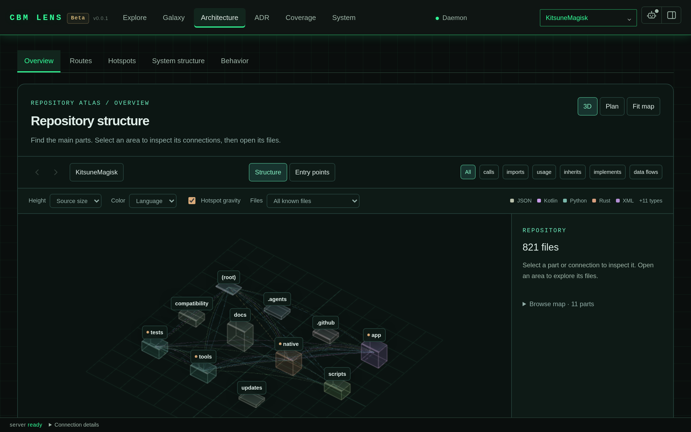

<div align="center">

# Codebase Memory for DeepSeek Harness

**Give your agent a map of the codebase instead of a bag of greps.**

[](https://www.npmjs.com/package/@lovedolove/dsh-codebase-memory-mcp)
[](LICENSE)
[](https://github.com/LoveDoLove/dsh-codebase-memory-mcp/actions/workflows/ci.yml)
[](https://m8ven.ai/badge/mcp/lovedolove/dsh-codebase-memory-mcp)
[](https://github.com/deepseek-ai/dsh)

[English](README.md) · [中文](README.zh-CN.md) · [Whitepaper](WHITEPAPER.md) · [Docs](docs/install.md)

</div>



## The problem

`grep` finds text. It does not know that `Object.handler` is called by three tools, that `apply` is the entry point, or that `src/engine.mjs` is imported by `src/index.mjs` and nothing else. Every time your agent needs to answer "who calls this", it greps, reads five files, and guesses.

This plugin gives DeepSeek Harness a real code graph. It bridges to [`codebase-memory-mcp`](https://github.com/lovedolove/codebase-memory-mcp), keeps the daemon running, and registers six tools that answer structural questions directly. The agent asks once and gets the call chain.

## Quick start

```sh
# 1. Install the plugin into your DSH profile
dsh plugin --profile web add @lovedolove/dsh-codebase-memory-mcp

# 2. Make sure the binary is on your PATH (or set CBM_EXE)
codebase-memory-mcp --version

# 3. Start the harness. The daemon starts with it.
dsh web
```

On startup you should see this on stderr:

```
[codebase-memory] 🔍 codebase-memory UI is live: http://localhost:9749/
```

Open <http://localhost:9749/> in a browser and the graph UI is already waiting. Build an index once, then ask the agent about any symbol.

```sh
# Index a repository (the tools do not index on their own)
codebase-memory-mcp cli --quiet index_repository '{"repo_path":"/absolute/path/to/repo"}'
```

Then just ask, or call a tool directly:

```ts
cbm_search   { name_pattern: ".*Handler.*" }
cbm_trace    { symbol: "Object.handler", direction: "inbound" }
cbm_snippet  { qualified_name: "app.auth.login" }
```

## What you get

| Tool | Answers |
| --- | --- |
| `cbm_projects` | What has been indexed, and how fresh is it |
| `cbm_search` | Which symbols match a name, label, or path pattern |
| `cbm_trace` | Who calls this, or what this calls, to a chosen depth |
| `cbm_snippet` | The exact source of one symbol |
| `cbm_arch` | How a directory is structured and what depends on what |
| `cbm_search_code` | A text search for literals, errors, and config values |

Above the tools, the plugin also gives you:

- **A live daemon.** It starts when the plugin applies, respawns if the child exits, and is disposed with the plugin. Nothing to supervise.
- **A `/cbm` command.** Prints the executable path, the UI URL, and every indexed project with its status.
- **A bundled agent skill.** Ranked at 600, model and user invocable, so the agent reaches for the graph before it reaches for grep.
- **Graceful degradation.** A missing binary logs one warning and the tools return a degraded result. The plugin never fails to load because the daemon is absent.
- **A reusable library.** Nine subpath exports, so you can drive the engine from your own code without a harness.

## How it works

```
DSH agent ──▶ cbm_* tool ──▶ engine ──▶ JSON-RPC over stdio ──▶ codebase-memory-mcp
                                                                      │
browser ──▶ http://localhost:9749/ ──▶ graph UI ◀────────────────────┘
```

Three layers, each replaceable on its own:

1. **Plugin entry** (`src/index.mjs`) reads the config, starts the daemon, and registers tools, prompt guidance, the skill, and the command.
2. **Engine** (`src/engine.mjs`) translates DSH argument names into upstream names, guards the repository boundary, and returns a degraded shape when the binary is missing.
3. **Client** (`src/client.mjs`) spawns the binary, speaks MCP JSON-RPC 2.0, and owns the process lifecycle.

[Read the architecture doc](docs/architecture.md) for the reasoning, and the [whitepaper](WHITEPAPER.md) for why the boundary sits where it does.

## Configuration

Every deployment can set these in `cordis.yml`:

```yaml
plugins:
  codebase-memory:
    exePath: /usr/local/bin/codebase-memory-mcp  # falls back to CBM_EXE, then PATH
    uiEnabled: true                              # default true
    port: 9749                                   # default 9749
    eagerStart: true                             # default true
```

Environment variables win where they apply. See [docs/configure.md](docs/configure.md) for the full discovery order.

| Variable | Purpose |
| --- | --- |
| `CBM_EXE` | Path to the `codebase-memory-mcp` binary |
| `CODEBASE_MEMORY_EXE` | Legacy alias for `CBM_EXE` |
| `DSH_HOME` | Where DSH stores state, including index metadata |

## Use it as a library

```js
import { CodeIntelligenceEngine } from '@lovedolove/dsh-codebase-memory-mcp/engine'

const engine = new CodeIntelligenceEngine()
const result = await engine.traceCallPath({
  repoRoot: '/path/to/repo',
  symbol: 'Object.handler',
  direction: 'inbound',
  depth: 3,
})

if (result.degraded) {
  console.error('No graph available:', result.message)
} else {
  console.log(result.raw)
}
```

The full surface is documented in [docs/library-api.md](docs/library-api.md).

## Requirements

| Requirement | Version |
| --- | --- |
| DeepSeek Harness | `>=0.2.0 <0.3.0` (`engines.dsh`) |
| Node.js | `>=18.0.0 <25.0.0` (`engines.node`) |
| `codebase-memory-mcp` | Any recent release |

The binary is required for indexing and queries. It is not required for the plugin to load.

The plugin declares five optional peers: `@deepseek-ai/cordis` at `>=4.0.1-rc.1 <5.0.0-0`, plus `@deepseek-ai/dsh-tools`, `@deepseek-ai/dsh-system-prompt`, `@deepseek-ai/dsh-skill`, and `@deepseek-ai/dsh-commands` at `>=0.2.0 <0.3.0-0`. A missing peer disables the matching feature and logs a warning. It never blocks startup.

## Documentation

| Document | Kind | Read it when |
| --- | --- | --- |
| [Install](docs/install.md) | How-to | You want the steps only |
| [Configure](docs/configure.md) | Reference | You need a flag, a variable, or a path |
| [Tools](docs/tools.md) | Reference | You are choosing a tool or an argument |
| [Architecture](docs/architecture.md) | Explanation | You want to know why it is built this way |
| [Library API](docs/library-api.md) | Reference | You are driving the engine yourself |
| [Troubleshooting](docs/troubleshooting.md) | How-to | Something does not work |
| [Whitepaper](WHITEPAPER.md) | Explanation | You want the design argument and the evidence |
| [AGENTS.md](AGENTS.md) | Reference | You are an agent working in this repo |

## Development

```sh
npm ci          # install dev dependencies
npm test        # 44 tests, node --test
npm run pack:check
```

The suite covers the client, engine, discovery, tools, watcher, bridge, and plugin lifecycle. Two tests boot a fake MCP server and assert the real handshake.

## Versioning

`publish-npm.yml` runs on every push to `main`. It stages the package with `npm stage publish`, which does not make a release public by itself. A human approves the staged version in an authenticated npm session. Release notes come from [CHANGELOG.md](CHANGELOG.md).

## License

MIT. See [LICENSE](LICENSE).

<div align="center">

If this saved you a grep, a star helps other people find it.

[](https://star-history.com/#LoveDoLove/dsh-codebase-memory-mcp&Date)

</div>
