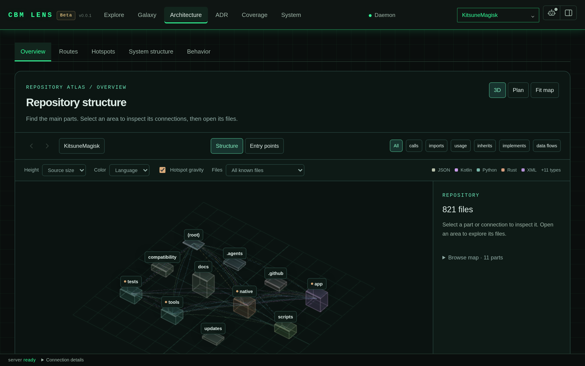

<div align="center">

# Codebase Memory for DeepSeek Harness

**给智能体一张代码地图，而不是一堆 grep。**

[](https://www.npmjs.com/package/@lovedolove/dsh-codebase-memory-mcp)
[](LICENSE)
[](https://github.com/LoveDoLove/dsh-codebase-memory-mcp/actions/workflows/ci.yml)
[](https://m8ven.ai/badge/mcp/lovedolove/dsh-codebase-memory-mcp)
[](https://github.com/deepseek-ai/deepseek-harness)

[English](README.md) · [中文](README.zh-CN.md) · [白皮书](WHITEPAPER.zh-CN.md) · [文档](docs/install.md)

</div>



## 问题在哪

`grep` 只能找到文本。它不知道 `Object.handler` 被三个工具调用，不知道 `apply` 是入口，也不知道 `src/engine.mjs` 只被 `src/index.mjs` 导入。每次智能体要回答"谁调用了这个函数"，它都得 grep、打开五个文件、然后猜。

这个插件给 DeepSeek Harness 一张真正的代码图谱。它连接 [`codebase-memory-mcp`](https://github.com/DeusData/codebase-memory-mcp)，保持守护进程运行，并注册六个直接回答结构性问题的工具。智能体问一次就能拿到调用链。

## 快速开始

```sh
# 1. 把插件装进你的 DSH profile
dsh plugin --profile web add @lovedolove/dsh-codebase-memory-mcp

# 2. 确认二进制在 PATH 上（或者设置 CBM_EXE）
codebase-memory-mcp --version

# 3. 启动 harness，守护进程会一起起来
dsh web
```

启动时你应该在 stderr 看到这一行：

```
[codebase-memory] 🔍 codebase-memory UI is live: http://localhost:9749/
```

在浏览器打开 <http://localhost:9749/>，图界面已经在等你了。先建一次索引，然后就可以问智能体任何符号。

```sh
# 给仓库建索引（工具本身不会自动建索引）
codebase-memory-mcp cli --quiet index_repository '{"repo_path":"/绝对路径/to/repo"}'
```

之后直接问，或者直接调用工具：

```ts
cbm_search   { name_pattern: ".*Handler.*" }
cbm_trace    { symbol: "Object.handler", direction: "inbound" }
cbm_snippet  { qualified_name: "app.auth.login" }
```

## 你能得到什么

| 工具 | 回答什么 |
| --- | --- |
| `cbm_projects` | 哪些项目已建索引，索引有多新 |
| `cbm_search` | 哪些符号匹配名称、标签或路径模式 |
| `cbm_trace` | 谁调用了它，或者它调用了谁，可以指定深度 |
| `cbm_snippet` | 某个符号的精确源码 |
| `cbm_arch` | 一个目录怎么组织，谁依赖谁 |
| `cbm_search_code` | 文本搜索，用来找字面量、报错信息、配置项 |

在工具之上，插件还提供：

- **常驻守护进程。** 插件加载时启动，子进程退出后下一次工具调用会重新拉起，插件销毁时一起关闭。你不需要盯着它。
- **`/cbm` 命令。** 打印二进制路径、图界面地址，以及每个已索引项目的状态。
- **内置智能体技能。** 排名 600，模型和用户都能调用，让智能体先想到图谱，再想到 grep。
- **优雅降级。** 二进制缺失时只打一条警告，工具返回降级结果。插件永远不会因为守护进程缺席而加载失败。
- **可复用的库。** 九个导出子路径，你可以不经过 harness，直接在自己的代码里驱动引擎。

## 工作原理

```
DSH agent ──▶ cbm_* tool ──▶ engine ──▶ JSON-RPC over stdio ──▶ codebase-memory-mcp
                                                                      │
browser ──▶ http://localhost:9749/ ──▶ graph UI ◀────────────────────┘
```

三层结构，每一层都可以单独替换：

1. **插件入口**（`src/index.mjs`）读取配置、启动守护进程、注册工具、系统提示词引导、技能和命令。
2. **引擎**（`src/engine.mjs`）把 DSH 的参数名翻译成上游参数名，守住仓库边界，在二进制缺失时返回降级结果。
3. **客户端**（`src/client.mjs`）拉起二进制、说 MCP JSON-RPC 2.0、管理进程生命周期。

设计理由见[架构文档](docs/architecture.md)，为什么边界划在这里见[白皮书](WHITEPAPER.zh-CN.md)。

## 配置

任何部署都可以在 `cordis.yml` 里设置这四项：

```yaml
plugins:
  codebase-memory:
    exePath: /usr/local/bin/codebase-memory-mcp  # 回退到 CBM_EXE，再回退到 PATH
    uiEnabled: true                              # 默认 true
    port: 9749                                   # 默认 9749
    eagerStart: true                             # 默认 true
```

环境变量在适用的地方优先。完整的查找顺序见 [docs/configure.md](docs/configure.md)。

| 变量 | 作用 |
| --- | --- |
| `CBM_EXE` | `codebase-memory-mcp` 二进制的路径 |
| `CODEBASE_MEMORY_EXE` | `CBM_EXE` 的旧别名 |
| `DSH_HOME` | DSH 存放状态的位置，包括索引元数据 |

## 作为库使用

```js
import { CodeIntelligenceEngine } from '@lovedolove/dsh-codebase-memory-mcp/engine'

const engine = new CodeIntelligenceEngine()
const result = await engine.traceCallPath({
  repoRoot: '/path/to/repo',
  symbol: 'Object.handler',
  direction: 'inbound',
  depth: 3,
})

if (result.degraded) {
  console.error('没有可用的图谱:', result.message)
} else {
  console.log(result.raw)
}
```

完整接口见 [docs/library-api.md](docs/library-api.md)。

## 环境要求

| 要求 | 版本 |
| --- | --- |
| DeepSeek Harness | `>=0.2.0 <0.3.0`（`engines.dsh`） |
| Node.js | `>=18.0.0 <25.0.0`（`engines.node`） |
| `codebase-memory-mcp` | 任意近期版本 |

二进制是建索引和查询所必需的，插件加载不需要它。

插件声明了五个可选 peer：`@deepseek-ai/cordis` 为 `>=4.0.1-rc.1 <5.0.0-0`，以及 `@deepseek-ai/dsh-tools`、`@deepseek-ai/dsh-system-prompt`、`@deepseek-ai/dsh-skill`、`@deepseek-ai/dsh-commands` 为 `>=0.2.0 <0.3.0-0`。缺少某个 peer 只会关掉对应功能并打一条警告，不会阻止启动。

## 文档

| 文档 | 类型 | 什么时候读 |
| --- | --- | --- |
| [安装](docs/install.md) | 操作指南 | 你只想要步骤 |
| [配置](docs/configure.md) | 参考 | 你要查一个参数、变量或路径 |
| [工具](docs/tools.md) | 参考 | 你在挑工具或参数 |
| [架构](docs/architecture.md) | 说明 | 你想知道为什么这么设计 |
| [库接口](docs/library-api.md) | 参考 | 你要自己驱动引擎 |
| [故障排查](docs/troubleshooting.md) | 操作指南 | 有东西不工作 |
| [白皮书](WHITEPAPER.zh-CN.md) | 说明 | 你要完整的设计论证和证据 |
| [Whitepaper](WHITEPAPER.md) | Explanation | 你要读英文版的设计论证和证据 |
| [AGENTS.md](AGENTS.md) | 参考 | 你是在这个仓库里工作的智能体 |

## 开发

```sh
npm ci          # 安装开发依赖
npm test        # 44 个测试，node --test
npm run pack:check
```

测试覆盖客户端、引擎、发现、工具、监听器、桥接和插件生命周期。其中两个测试会启动一个假的 MCP 服务端，验证真实的握手过程。

## 版本发布

`publish-npm.yml` 在每次推送到 `main` 时运行。它用 `npm stage publish` 把包放进暂存区，这一步本身不会公开发布。需要有人在已登录的 npm 会话里批准暂存的版本。发布说明取自 [CHANGELOG.md](CHANGELOG.md)。

## 许可证

MIT，见 [LICENSE](LICENSE)。

<div align="center">

如果它帮你省下了一次 grep，一个 star 能让更多人找到它。

[](https://star-history.com/#LoveDoLove/dsh-codebase-memory-mcp&Date)

</div>
